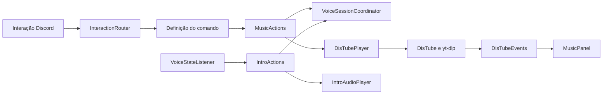

# Sr Incrível

Bot de Discord em JavaScript para reprodução de música, áudios de entrada e rolagem de dados.

## Requisitos

- Node.js **26.x** e npm.
- Token de um bot e ID do servidor Discord.
- Permissões do bot: Ver canais, Enviar mensagens, Inserir links, Conectar e Falar.
- Acesso à internet para instalar dependências e reproduzir mídia.

## Instalação e execução

Na pasta do projeto:

```powershell
npm ci
Copy-Item .env.example .env
npm run setup:hooks
```

Preencha `.env`:

```dotenv
TOKEN=token_do_bot
GUILD_ID=id_do_servidor
INTROS_ENABLED=true
```

Inicie o bot:

```powershell
npm start
```

O Node carrega o arquivo de ambiente nativamente. Depois do login, o bot registra os comandos no servidor configurado. O registro substitui a lista anterior de comandos desse bot nesse servidor.

### Configuração

| Variável | Obrigatória | Valor padrão | Função |
| --- | --- | --- | --- |
| `TOKEN` | Sim | — | Token de autenticação do bot. |
| `GUILD_ID` | Sim | — | ID do servidor onde os comandos são registrados. |
| `INTROS_ENABLED` | Não | `true` | Liga ou desliga os áudios de entrada. Aceita `true`, `false`, `1` e `0`. |

Para executar com intros desligadas no PowerShell:

```powershell
$env:INTROS_ENABLED = 'false'
npm start
```

Variáveis já definidas no ambiente têm precedência sobre `.env`. Para ligar novamente, atribua `true`; para voltar ao valor do arquivo, use `Remove-Item Env:INTROS_ENABLED`. Essa configuração é lida na inicialização e exige reiniciar o processo para mudar.

Com intros desligadas, o bot não lê o cadastro, não cria o player de intros e não conecta o listener de intros aos eventos de voz. As conexões e os eventos internos necessários à reprodução de música continuam funcionando.

## Comandos

| Comando | Função |
| --- | --- |
| `/play musica` | Busca pelo nome no YouTube ou reproduz uma URL suportada pelo yt-dlp. |
| `/pause` | Pausa ou retoma a música. |
| `/resume` | Retoma uma música pausada. |
| `/skip` | Avança para a próxima música. |
| `/previous` | Volta à música anterior. |
| `/stop` | Para a fila e desconecta o bot. |
| `/sair` | Desconecta o bot, inclusive durante uma intro. |
| `/autoplay` | Alterna a busca de próximas músicas por título e artista no YouTube. |
| `/roll dados` | Rola dados no formato `2d6`. |

Controles de música exigem que o usuário esteja no mesmo canal de voz do bot. As respostas são privadas, exceto `/roll`. O painel de música é publicado no canal de texto; botões antigos são rejeitados.

O autoplay consulta até dez vídeos e exclui o vídeo atual. Fontes externas ao YouTube não fornecem autoplay. Links de Spotify e Deezer não são convertidos em músicas do YouTube. A disponibilidade de uma URL depende do suporte do yt-dlp e das regras do provedor.

`/chat`, a integração de IA e os comandos de mensagens pessoais foram removidos. `/ouvir` permanece desativado; seu código anterior está isolado em `experimental/voice` e não faz parte da instalação ativa.

## Áudios de entrada

O cadastro local `src/utils/usuarios.json` associa IDs Discord a arquivos em `src/intros`. Ambos são privados e ignorados pelo Git. Use `src/config/usuarios.example.json` como modelo:

```json
{
  "123456789012345678": { "audio": "entrada.mp3" }
}
```

O arquivo de áudio deve existir em `src/intros`, e o cadastro deve conter somente o nome do arquivo, sem caminhos. Um nome vazio desativa a intro daquele usuário. Sem cadastro, o bot inicia normalmente sem tocar intros. Quando as intros estão habilitadas, um cadastro inválido impede a inicialização; quando estão desabilitadas, ele não é lido.

A entrada de um usuário humano em um canal de voz pode iniciar sua intro. Saída do canal, eventos de bots e alterações apenas de mute/deaf não iniciam reprodução. Intros ignoradas por uma sessão ocupada não são enfileiradas para tocar depois.

### Coordenação entre intros e música

`VoiceSessionCoordinator` coordena o uso da conexão por **servidor**. Ele não reproduz áudio: mantém reservas temporárias e consulta o estado atual de `DisTubePlayer`.

- `state(guildId)`: retorna a reserva existente; se não houver reserva, consulta a fila/conexão de música.
- `authorize(input)`: exige um canal de voz e verifica se é o mesmo da sessão atual.
- `reserveMusic(input)`: reserva o servidor antes da busca assíncrona. Rejeita intro ativa ou outra busca pendente.
- `reserveIntro(guildId, channelId)`: reserva somente se não houver reserva, fila ou conexão de música.
- `requireReady(guildId)`: impede controles enquanto uma música está carregando.
- `release(guildId, reservation)`: remove somente a mesma reserva recebida, preservando sessões mais recentes.

| Estado no servidor | Nova intro | Pedido de música ou controle |
| --- | --- | --- |
| Livre | Pode começar se o usuário tiver áudio configurado. | `/play` pode começar a busca. |
| Intro reservada ou tocando | Ignorada. | `/play` pede para aguardar; `/sair`, no mesmo canal, encerra a intro. |
| Música carregando | Ignorada. | Outra busca, controles e `/sair` pedem para aguardar o carregamento. |
| Fila tocando ou pausada | Ignorada. | Ações permitidas para usuários no mesmo canal. |
| Conexão de música sem fila | Ignorada. | Controles de fila retornam ausência de músicas; `/sair` pode liberar a conexão. |

O fluxo de música reserva a sessão antes de aguardar o player. A reserva é liberada em `finally`, tanto no sucesso quanto na falha. Depois do sucesso, a fila existente continua impedindo intros, mesmo pausada. A música não é misturada com a intro nem interrompida para tocá-la.

O fluxo de intro mantém sua reserva após o início da reprodução. `IntroAudioPlayer` encerra o player e a conexão ao terminar, desconectar ou falhar; seu callback `onEnd` libera a reserva. Se o início da reprodução falhar, `IntroActions` também libera a reserva.

Cada reserva é um objeto exclusivo. Uma liberação atrasada só pode remover esse mesmo objeto. O player de intro também verifica a identidade de sua sessão antes de destruir recursos, impedindo que eventos antigos encerrem uma reprodução nova. Servidores diferentes podem reproduzir áudio simultaneamente.

## Arquitetura

O projeto usa uma organização inspirada em Clean Architecture e portas e adaptadores. Regras recebem IDs e estados simples, enquanto objetos nativos do Discord e DisTube ficam nos adaptadores. O bootstrap fornece as dependências pelos construtores, sem framework de injeção.

| Caminho | Responsabilidade |
| --- | --- |
| `index.js` | Inicialização e sinais de encerramento do processo. |
| `src/bootstrap` | Criação dos componentes e conexão de suas dependências e callbacks. |
| `src/application/music` | Ações de música e suas condições de autorização. |
| `src/application/intros` | Decisão de quando iniciar uma intro. |
| `src/application/audio` | Coordenação das reservas de voz por servidor. |
| `src/application/dice` | Validação e sorteio de dados. |
| `src/application/errors` | Falhas semânticas identificadas por códigos. |
| `src/adapters/discord` | Login, registro de comandos, roteamento e tradução de eventos. |
| `src/adapters/discord/commands` | Definições dos comandos e conversão das interações em dados da aplicação. |
| `src/adapters/discord/presentation` | Mensagens, embeds, botões e gestão dos painéis. |
| `src/adapters/audio` | Players concretos, eventos do DisTube e execução do yt-dlp. |
| `src/config` | Leitura e validação do ambiente e do cadastro opcional. |
| `tests` | Testes locais das regras, adaptadores e fluxos. |
| `scripts` | Verificações de sintaxe, áudio, extração e privacidade. |

`MusicActions` usa uma porta de player: um objeto com métodos como `state`, `play`, `pause`, `resume`, `stop` e `leave`. `DisTubePlayer` implementa esse contrato com a biblioteca real; os testes usam implementações controladas. A aplicação não importa adaptadores, SDKs ou leitores de configuração.



No `/play`, o roteador encontra a definição e reconhece a interação. O comando extrai IDs e consulta. A aplicação verifica o canal e reserva a sessão; o adaptador resolve os IDs e chama DisTube. O evento `playSong` é traduzido para dados simples e encaminhado ao painel pelo callback configurado no bootstrap. O resultado da ação é traduzido para a confirmação privada.

### Como os comandos são identificados

`CommandRegistry` importa uma lista explícita dos nove módulos ativos. Ele não varre a pasta de comandos. **Para adicionar um comando, é necessário importar o módulo e incluí-lo nessa lista.** Definições inválidas ou nomes duplicados impedem a criação do registro.

O nome público é definido por `SlashCommandBuilder.setName`, disponível em `command.data.name`. Esse nome é a chave do `Map` usado pelo registro. O nome do arquivo não define o comando.

| Arquivo | Nome público/chave | Ação da aplicação |
| --- | --- | --- |
| `commands/music/play.js` | `play` | `music.play` |
| `commands/music/pause.js` | `pause` | `music.pause` |
| `commands/music/leave.js` | `sair` | `music.leave` |

Por exemplo, `leave.js` usa `createMusicCommand('sair', descrição, 'leave')`. A fábrica define `/sair`, mas executa o método `leave` da aplicação. A fábrica é um auxiliar compartilhado, não outra definição de comando.

Após o evento `ClientReady`, `registry.register` envia `data.toJSON()` ao Discord: nomes, descrições e opções. As funções `execute` ficam no processo Node. Quando chega uma interação, o roteador consulta o registro usando `interaction.commandName` para slash commands ou `interaction.customId` para botões, reconhece a interação e executa a definição encontrada.

Os botões usam IDs como `pause`, `skip`, `previous`, `stop` e `autoplay`, que correspondem às chaves do registro. A propriedade `button` limita quais definições aceitam botões, e o painel verifica se a mensagem ainda é atual.

A implementação anterior descobria arquivos automaticamente, mas também identificava comandos por `data.name`. A mudança foi na descoberta: agora os módulos ativos estão declarados explicitamente. Criar um arquivo sozinho não ativa um comando. Depois de adicioná-lo à lista, reinicie o bot para registrar a definição no Discord.

## Dependências e áudio

| Biblioteca | Papel |
| --- | --- |
| `discord.js` | Cliente Discord, interações, registro, mensagens e componentes. |
| `@discordjs/voice` | Conexões de voz, players e transmissão de áudio, incluindo suporte a DAVE. |
| `distube` | Filas de música, controles, histórico e autoplay. |
| `@distube/yt-dlp` | Instala o executável usado pelo adaptador para metadados e URLs de áudio. |
| `ffmpeg-static` | Instala FFmpeg para decodificar áudio de URLs e arquivos locais. |
| `opusscript` | Codifica áudio em Opus usando WebAssembly, sem compilação C++ na instalação. |

O yt-dlp é executado com `--skip-download` e `--simulate`: consulta informações e encontra a URL do stream, sem salvar a música inteira. FFmpeg lê e decodifica o áudio, que é codificado em Opus e enviado ao Discord pela biblioteca de voz. A reprodução transfere áudio pela rede.

WebAssembly permite executar a biblioteca de codificação compilada dentro do Node. O encoder não exige navegador nem serviço externo. As versões exatas e a árvore de dependências são fixadas em `package.json` e `package-lock.json`.

Os executáveis são baixados durante a instalação. Para reinstalá-los e atualizar o yt-dlp instalado, execute `npm rebuild @distube/yt-dlp ffmpeg-static`.

## Desenvolvimento e testes

```powershell
npm test
npm run test:coverage
npm run check
npm run check:audio
npm run check:extractor
npm run check:privacy
```

| Verificação | O que valida |
| --- | --- |
| `npm test` | Regras, autorização, configuração, concorrência, limpeza de voz, roteamento, registro e ciclo de vida usando recursos controlados. |
| `npm run test:coverage` | Cobertura de linhas, condições e funções dos arquivos ativos de `src`, com o runner nativo do Node. |
| `npm run check` | Sintaxe de código ativo, scripts e testes. |
| `npm run check:audio` | Encoder Opus, FFmpeg, yt-dlp e dependências da camada de voz. |
| `npm run check:extractor` | Consulta real de metadados e URL de áudio pública, sem baixar mídia ou iniciar o bot. Aceita uma URL ou texto de busca após `--`, como `npm.cmd run check:extractor -- "bad omens"`. |
| `npm run check:privacy` | Arquivos privados rastreados e padrões comuns de credenciais no conteúdo staged. |

Os testes não fazem login real, registro real de comandos ou transmissão de voz no Discord. Bibliotecas externas e subprocessos têm verificações adicionais; cobertura alta de código local não substitui uma validação de uso em um servidor com as permissões corretas.

O estilo usa dois espaços, aspas simples, ponto e vírgula e limite preferencial de 100 colunas. `.editorconfig` e `.prettierrc.json` orientam editores e formatadores; `.prettierignore` exclui dados privados e a implementação experimental.

## Privacidade e versionamento

Não versione `.env`, cadastro de usuários, áudios pessoais, avatares, cookies, exportações, chaves ou caches. O hook instalado com `npm run setup:hooks` executa a verificação de privacidade antes de commits, sem exibir valores detectados.

`.gitignore` protege novas inclusões; ele não remove dados já presentes em commits antigos. Credenciais expostas precisam ser revogadas, mesmo quando o histórico é limpo. A versão de histórico sanitizado preparada durante a revisão permanece separada até sua publicação autorizada; o histórico público ainda não foi substituído.
